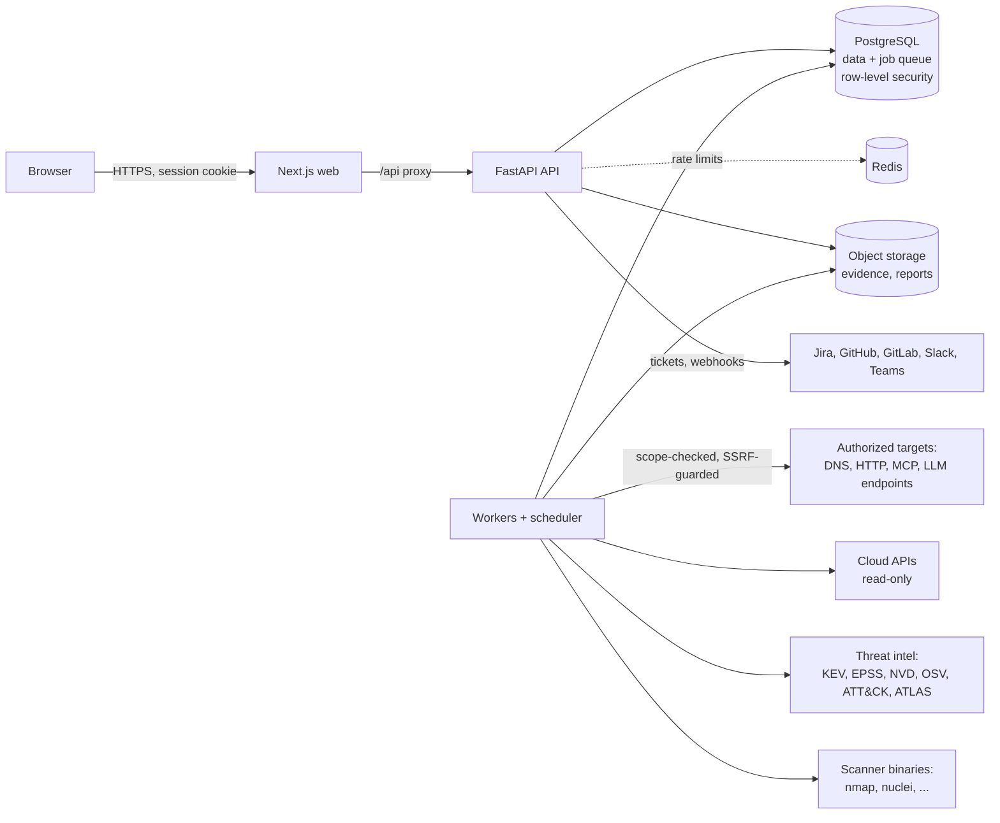

# CTEM Platform

A multi-tenant Continuous Threat Exposure Management platform that discovers assets, assesses them, scores findings by contextual risk, derives attack paths from evidence-backed relationships, and tracks remediation through verified retest. AI systems (model endpoints, agents, MCP servers, RAG stores, model artifacts) are inventoried and assessed in the same data model as conventional infrastructure.

Version `0.2.0`. What has and has not been verified against real systems is listed under [Available integrations](#available-integrations) and [Known limitations](#known-limitations).

## Product overview

The platform follows the exposure-management lifecycle:

```
DISCOVER → INVENTORY → ASSESS → VALIDATE → PRIORITIZE → REMEDIATE → MONITOR
```

- **Discover / inventory.** Engines and connectors write to one asset inventory keyed by a type-qualified canonical identifier. Relationships between assets form the asset graph.
- **Assess.** Assessment engines and imported scanner reports produce normalised findings with stored evidence.
- **Validate.** Findings carry a confidence level (`confirmed`, `firm`, `tentative`). A finding is marked remediated only by a retest that no longer observes it or a recorded manual verification.
- **Prioritize.** A risk engine combines severity, exploitation intelligence, exposure, asset context, attack-path position and AI-specific factors, and stores the full breakdown.
- **Remediate / monitor.** Ownership, SLAs, tasks, tickets, risk acceptance with separation of duties, policies, notifications and scheduled re-assessment.

## Core capabilities

| Area | What is implemented |
| --- | --- |
| Asset inventory | 33 asset types, de-duplication by canonical identifier, relationships (15 types), discovery provenance and change history, ownership, classification, server-side search/filter/sort |
| Authorized scope | Every engine refuses targets not covered by a recorded authorization; active techniques and private networks need separate flags |
| Attack surface | DNS and certificate-transparency discovery, SPF/DMARC/CAA and dangling-CNAME checks, HTTP header/cookie/CORS analysis, TLS inspection, exposed files and management consoles, Nmap service discovery |
| Vulnerabilities | Catalogue with CVSS, EPSS and CISA KEV; scanner import (10 formats); SBOM (CycloneDX, SPDX) and lockfile analysis against OSV; Nuclei execution |
| Web & API | OpenAPI/Swagger analysis with optional read-only probes for unenforced authentication; Semgrep, ZAP and SARIF import |
| Cloud | AWS read-only posture (IAM, S3, EC2, RDS, CloudTrail, KMS, EKS) with identity and permission relationships; Azure/GCP through Prowler import |
| AI security | AI asset discovery in repositories, shadow-AI detection against an approved-provider list, MCP configuration review and live probe, inference endpoint probe, model artifact inspection, agent/RAG posture rules |
| AI red team | 15 deterministic tests under an enforced authorization, scope, budget and rate-limit envelope |
| Threat intelligence | CISA KEV, EPSS, NVD, OSV, MITRE ATT&CK and ATLAS, with source attribution |
| Attack paths | Evidence-graded paths (verified / probable / theoretical) from exposed entry points to critical assets, with graph view |
| Risk | Transparent scoring, configurable policy, risk acceptance with approval and expiry |
| Remediation | Tasks, SLAs, retest, manual verification, GitHub/GitLab/Jira ticket creation |
| Governance | Rule-based policies with exceptions and evaluation history; 13 default policies |
| Reporting | 10 report types in PDF, XLSX, CSV and JSON |
| Platform | Multi-tenancy with PostgreSQL row-level security, RBAC (9 built-in roles), TOTP MFA, hash-chained audit log, durable job queue, notifications with storm control |

## Architecture overview

A modular monolith (FastAPI) with separate worker processes. The browser talks only to the Next.js server, which proxies `/api/*` to the API. Assessment execution happens only in workers. PostgreSQL is the system of record and also the job queue.



Details: [docs/architecture.md](docs/architecture.md). Decisions: [docs/adr/](docs/adr/).

## Technology stack

| Layer | Choice |
| --- | --- |
| API | Python 3.12, FastAPI, Pydantic 2, SQLAlchemy 2 (sync, psycopg 3), Alembic |
| Data | PostgreSQL 17 (row-level security, `pg_trgm`), Redis 7 (rate limiting), local or S3-compatible object storage |
| Jobs | PostgreSQL-backed queue (`FOR UPDATE SKIP LOCKED`) with an in-process scheduler ([ADR 0002](docs/adr/0002-postgres-job-queue.md)) |
| Frontend | Next.js 16 (App Router), React 19, TypeScript (strict), Tailwind CSS 4, TanStack Query and Table, React Hook Form, Zod, Recharts, React Flow |
| Security libraries | argon2-cffi (Argon2id), cryptography (Fernet), pyotp, defusedxml |
| Observability | structlog (JSON), Prometheus metrics, optional OpenTelemetry tracing |
| Tooling | uv, ruff, mypy, pytest, moto; pnpm, ESLint, Vitest, Testing Library |

UI components follow the shadcn/ui approach (small local primitives styled with Tailwind) but are written in `frontend/components/ui.tsx` rather than generated by the shadcn CLI.

## Repository structure

```
backend/
  app/
    api/            dependencies (authentication, RBAC, pagination) and router aggregation
    core/           configuration, security primitives, SSRF-guarded HTTP, rate limiting, storage, logging
    db/             declarative base, tenant-scoped sessions
    models/         SQLAlchemy models (48 tables)
    domains/        one package per domain: auth, admin, assets, findings, assessments, risk, policy,
                    attack_paths, remediation, intel, ai, analytics, notifications, reports, audit, ...
    engines/        assessment engines (dns_discovery, http_exposure, openapi_analysis, scanners,
                    aws_posture, ai/*, ai_redteam/*)
    integrations/   connector framework, scanner parsers, intel sources, ticketing, notification channels, LLM clients
    workers/        job queue and worker/scheduler process
    cli.py          operational commands
  migrations/       Alembic migrations (schema, then row-level security and grants)
  tests/            pytest suite (runs against a real PostgreSQL)
frontend/
  app/              routes: (auth) sign-in and registration, (app) the 19 navigation sections
  components/       UI primitives, server-driven data table, graph, application shell
  features/         shared feature components (findings table, assessments panel, module page)
  lib/              API client, hooks, validation schemas, formatters
  tests/            Vitest unit and component tests
infrastructure/     docker (database role bootstrap), kubernetes, monitoring
scripts/            dev-db.sh, lab.py (local practice targets), lab_walkthrough.py
docs/               architecture, deployment, security, integrations, AI security, development, API, ADRs
```

## Prerequisites

- Python 3.12 and [uv](https://docs.astral.sh/uv/)
- Node.js 22 or later and pnpm 9
- PostgreSQL 17 (15+ should work; 17 is what is tested) and, optionally, Redis 7
- Optional scanner binaries on workers: `nmap`, `nuclei`, `trivy`, `grype`, `semgrep`, `gitleaks`, `checkov`
- Or Docker with Compose v2 for the containerised path

## Local development setup

```bash
./scripts/dev-db.sh                      # PostgreSQL on :54329 and Redis on :63799, with dev roles and databases
cd backend && uv sync && uv run alembic upgrade head
CTEM_COOKIE_SECURE=false uv run uvicorn app.main:app --reload --port 8000   # terminal 1
uv run python -m app.workers.runner                                          # terminal 2
cd ../frontend && pnpm install && pnpm dev                                   # terminal 3
```

Open <http://localhost:3000>, choose **Create an account**, and register an organization. Without SMTP configured, account emails are not sent; in development the verification and reset links are written to the API log.

The defaults in `backend/app/core/config.py` match `scripts/dev-db.sh`, so no `.env` file is needed for development. `make dev-db`, `make api`, `make worker`, `make web` wrap the same commands.

### Trying it against local practice targets

```bash
python3 scripts/lab.py                   # deliberately weak web app, API, MCP server and toy model on 127.0.0.1:8808
```

Run the API and worker with `CTEM_ALLOW_PRIVATE_TARGETS=true`, then in **Administration → Authorized scope** authorize `http://127.0.0.1:8808` as a URL with *active testing* and *private network*. Create assessments from the UI, or run the scripted walkthrough:

```bash
CTEM_EMAIL=you@example.com CTEM_PASSWORD='...' python3 scripts/lab_walkthrough.py
```

## Docker deployment

```bash
cp .env.example .env        # set CTEM_SECRET_KEY, CTEM_ENCRYPTION_KEYS and the three database passwords
docker compose up --build
```

This starts PostgreSQL (creating the `ctem_owner` and `ctem_app` roles), Redis, a one-shot migration job, the API, one worker and the web frontend on port 3000. For plain-HTTP local use set `CTEM_COOKIE_SECURE=false` and `CTEM_ENV=development`; production mode refuses to start with insecure settings.

> The Dockerfiles and Compose file have not been built in the environment where this release was developed (no container runtime was available). They are exercised by the `images` job in CI. Treat the first build as unverified.

## Environment configuration

All settings are environment variables with the `CTEM_` prefix; the complete list with comments is in [.env.example](.env.example). The ones that matter most:

| Variable | Purpose |
| --- | --- |
| `CTEM_ENV` | `development`, `test` or `production`. Production validates that secrets and secure cookies are configured. |
| `CTEM_DATABASE_URL` | Runtime connection as the non-owner role (`ctem_app`). |
| `CTEM_MIGRATION_DATABASE_URL` | Migration connection as the schema owner (`ctem_owner`). |
| `CTEM_SECRET_KEY` | Keys the HMAC used to hash session and one-time tokens. |
| `CTEM_ENCRYPTION_KEYS` | Fernet keys for integration credentials and MFA secrets. First key encrypts; all decrypt. |
| `CTEM_REDIS_URL` | Shared rate limiting. Required when more than one API process runs. |
| `CTEM_ALLOW_PRIVATE_TARGETS` | Allows assessing private addresses that are also authorized in scope. Default `false`. |
| `CTEM_REPO_SCAN_ROOT` | Directory on workers under which repositories may be analysed. Empty disables path targets. |
| `CTEM_ALLOW_REGISTRATION` | Self-service organization registration. Disable after onboarding. |
| `CTEM_TRUSTED_PROXIES` | CIDRs of reverse proxies whose `X-Forwarded-For` is trusted for the client address (rate limits, audit log). |
| `CTEM_ALLOW_SERVER_CLAUDE_CREDENTIALS` | Lets organizations use the server's own Claude credentials for AI analysis. Default `false`. |
| `CTEM_BACKEND_URL` | Frontend build-time setting: the API origin the Next.js server proxies to. |

## Database setup

Two roles are required. Migrations fail with an explanatory error if the application role is missing.

```sql
CREATE ROLE ctem_owner LOGIN PASSWORD '...';
CREATE ROLE ctem_app   LOGIN PASSWORD '...' NOSUPERUSER NOBYPASSRLS;
CREATE DATABASE ctem OWNER ctem_owner;
```

`scripts/dev-db.sh` and `infrastructure/docker/postgres/10-roles.sh` do this for development and Compose. The application role must not be a superuser or have `BYPASSRLS`, otherwise tenant isolation is not enforced by the database. Use `CTEM_APP_DB_ROLE` if you name the role differently.

## Database migrations

```bash
cd backend
uv run alembic upgrade head                           # apply
uv run alembic revision --autogenerate -m "message"   # create after changing models
uv run alembic check                                  # verify models and migrations agree
```

New tenant-owned tables must be added to a migration that enables row-level security for them; `tests/test_isolation_security.py` fails if a table with `organization_id` lacks forced RLS.

## Running backend services

```bash
cd backend && uv run uvicorn app.main:app --host 0.0.0.0 --port 8000 --proxy-headers
```

Health: `GET /healthz` (liveness), `GET /readyz` (database and Redis), `GET /metrics` (Prometheus).

## Running frontend services

```bash
cd frontend && pnpm dev                                   # development
CTEM_BACKEND_URL=http://127.0.0.1:8000 pnpm build && pnpm start   # production build
```

## Running background workers

```bash
cd backend && uv run python -m app.workers.runner
```

A worker executes queued jobs (assessments, imports, reports, notification delivery, risk recalculation, attack-path computation) and runs the scheduler (recurring assessments, hourly SLA and risk-acceptance checks, daily policy evaluation and KEV/EPSS refresh). Run as many as needed; claiming is concurrency-safe and scheduling is serialised with an advisory lock. `CTEM_WORKER_METRICS_PORT` exposes worker metrics. `uv run python -m app.cli run-pending` drains the queue once without a scheduler.

## Running tests

```bash
cd backend && uv run pytest              # 102 tests; needs the PostgreSQL from scripts/dev-db.sh
cd frontend && pnpm test                 # 20 tests
cd frontend && pnpm lint && pnpm typecheck && pnpm build
```

Backend tests run against a real PostgreSQL database (`ctem_test`) because row-level security cannot be tested otherwise. They execute `nmap` and `nuclei` against loopback listeners when those binaries are installed and skip those two tests when not. External APIs (CISA, FIRST, OSV, AWS, ticketing, LLM providers) are replaced by fixtures; no test contacts the internet.

## Available integrations

The **Integrations** page lists every integration with how it is used: *connect* (the platform calls the system's API with stored credentials), *tool* (workers run the tool; its reports can also be uploaded), *upload* (reports are uploaded and normalised) and *feed* (public data synchronised by workers). The last column records what each was verified against during development.

| Integration | How it is used | Verified against |
| --- | --- | --- |
| Nmap, Nuclei | Tool | Real binaries scanning local listeners |
| Trivy, Grype, Semgrep, Gitleaks, Checkov | Tool, or report upload | Real binaries (Trivy 0.76, Grype 0.121, Semgrep 1.185, Gitleaks 8.30, Checkov 3.4) scanning a sample repository |
| OWASP ZAP, Prowler (AWS, Azure, Google Cloud, Kubernetes), SARIF, CycloneDX/SPDX SBOM | Report upload | Representative report files |
| CISA KEV, FIRST EPSS, NIST NVD, MITRE ATT&CK, MITRE ATLAS | Feed | The live public sources (1,779 KEV entries, 765 ATT&CK and 278 ATLAS objects, CVSS 3.1 and 4.0 from NVD) |
| OSV | Queried during dependency and SBOM analysis | The live OSV API |
| DNS and certificate transparency | Built-in discovery | Live public DNS and crt.sh |
| AWS | Connect (read-only) | moto, an in-process emulation of the AWS APIs. Not yet run against a real account |
| GitHub Issues, GitLab Issues, Jira Cloud | Connect | Recorded API request and response shapes. Not yet run against real accounts |
| Webhook (HMAC-signed), Slack, Microsoft Teams | Connect | Local receivers. Not yet posted to real Slack or Teams workspaces |
| Email (SMTP) | Built-in | A local SMTP server |
| Claude | Connect (Administration → AI analysis) | The official SDK against a recorded API stand-in. Not yet called with a real key |
| Model endpoints for the AI red team: OpenAI-compatible, Claude, Gemini, custom HTTP | Connect | Recorded API stand-ins and the local lab model |

Not available: GitHub/GitLab as repository sources (repositories are analysed from a path on the workers), native Azure and Google Cloud connectors (use Prowler upload), ScoutSuite, live Kubernetes inventory.

Details and required permissions: [docs/integrations.md](docs/integrations.md).

## Security modules

Seventeen assessment engines are registered (`GET /api/v1/assessments/engines`): `dns_discovery`, `http_exposure`, `nmap_scan`, `nuclei_scan`, `openapi_analysis`, `scanner_import`, `trivy_scan`, `grype_scan`, `semgrep_scan`, `gitleaks_scan`, `checkov_scan`, `aws_posture`, `repository_analysis`, `mcp_probe`, `ai_endpoint_probe`, `ai_posture_review`, `ai_redteam`. Each declares whether it is active (sends traffic to targets), its accepted target kinds, required tool or connector, and a typed configuration schema from which the UI builds its form.

## Connecting Claude

AI features (finding and attack-path explanations, and the executive briefing on the Overview page) use Claude. An organization administrator connects it under **Administration → AI analysis**:

- **Claude Console API key.** Create a key at platform.claude.com → Settings → API keys. The platform checks it against the Models API (which is free), lists the models the key can use, and stores the key encrypted.
- **Server sign-in.** When the deployment sets `CTEM_ALLOW_SERVER_CLAUDE_CREDENTIALS=true`, organizations can instead use the server's own credentials, resolved by the Anthropic SDK: `ANTHROPIC_API_KEY`, an `ant auth login` sign-in for local use, or workload identity federation in production. Nothing is stored in the platform, and usage is billed to the operator's Console organization, so leave this off on shared deployments.

Usage is billed to a Claude Console organization. **Claude Pro, Max and Team plans do not include API access** and cannot be used for this. The default model is `claude-opus-5-5`; requests enable Claude's server-side refusal fallback. Monthly token budgets, per-request limits and the option to include evidence in prompts are set on the same page.

## AI security capabilities

- **Discovery.** `repository_analysis` detects 26 AI technologies (providers, frameworks, vector databases, serving runtimes, MCP SDKs) from dependencies, imports, endpoints and environment variable names; AI provider credentials committed to source (value never stored); MCP client configuration; model artifacts.
- **Shadow AI.** Providers not on the organization's approved list produce findings. With no list configured, usage is reported as *unknown*, not *unapproved*. Visibility is limited to analysed sources and stated as such in the UI.
- **MCP.** Static review of server definitions (plaintext transport, literal secrets, unpinned packages, broad filesystem roots, privileged launch, auto-approved tools) and a live probe that performs `initialize`, `tools/list`, `resources/list`, `prompts/list` only. `tools/call` is never sent; a hard guard enforces this.
- **Models.** Pickle streams are disassembled without execution; references to code-execution callables are reported with opcode evidence and wording that does not claim malice.
- **Posture.** Rules over declared agent tools, autonomy, memory, identity, RAG authorization and tenant isolation, mapped to OWASP LLM Top 10 (2025), MITRE ATLAS and NIST AI RMF.
- **Red team.** Marker- and canary-based tests; a test is *vulnerable* only when the planted value or forbidden tool call appears in the response. Tools the target requests are recorded, never executed.

See [docs/ai-security.md](docs/ai-security.md).

## API documentation

Interactive OpenAPI documentation is served at `/api/docs` and the schema at `/api/openapi.json` (107 paths under `/api/v1`). Conventions and examples: [docs/api.md](docs/api.md).

```bash
TOKEN=$(curl -s localhost:8000/api/v1/auth/login -H 'content-type: application/json' \
  -d '{"email":"you@example.com","password":"..."}' | python3 -c 'import sys,json;print(json.load(sys.stdin)["access_token"])')
curl -s "localhost:8000/api/v1/findings?open_only=true&risk_level=critical&sort=risk_score&order=desc" -H "authorization: Bearer $TOKEN"
```

## Authentication and RBAC

- Email and password with Argon2id; account lockout; TOTP MFA; opaque server-side sessions (stored hashed) with idle and absolute expiry and per-session revocation; password reset and email verification with single-use tokens.
- Browsers use an `HttpOnly`, `SameSite=Lax` cookie plus a CSRF token on unsafe methods. API clients use `Authorization: Bearer`.
- 33 permissions; nine built-in roles (Super Administrator, Organization Administrator, Security Administrator, Security Analyst, Vulnerability Manager, Cloud Security Engineer, Red Team Operator, Auditor, Read-only User) plus custom roles. Nobody can grant a permission they do not hold, change their own role, or administer a more privileged account.
- Optional enforcement of email verification (`CTEM_REQUIRE_EMAIL_VERIFICATION`).
- Platform operators (`python -m app.cli grant-super-admin <email>`) get an **All organizations** console to see each organization's size and suspend or reinstate it, without access to its data.
- OAuth/OIDC single sign-on is not available.

## Multi-tenancy

Every tenant-owned table has `organization_id` and a forced row-level security policy. Each transaction sets `app.current_org`; a row is visible or writable only when it matches. The API and workers connect as a role that cannot bypass RLS. Background jobs run inside a session scoped to the job's organization. Global reference data (vulnerability catalogue, threat intelligence) is shared and contains no tenant data. See [ADR 0001](docs/adr/0001-tenant-isolation-rls.md).

## Security considerations

Summarised here; full detail in [docs/security.md](docs/security.md) and [SECURITY.md](SECURITY.md).

- All server-initiated HTTP goes through one client that resolves, validates and pins the destination address; link-local and metadata addresses are always refused.
- Integration credentials are encrypted at rest and never returned by the API; evidence passes through a credential redactor before storage.
- The audit log is append-only for the application role and hash-chained per organization.
- Uploads are restricted by extension and content signature, stored under generated keys, and always served as attachments.
- AI-assisted analysis is advisory, schema-validated, budgeted, and has no ability to change findings.

## Production deployment

Reference Kubernetes manifests are in `infrastructure/kubernetes/`; guidance on TLS termination, secrets, scaling, scanner images and network policy is in [docs/deployment.md](docs/deployment.md). Minimum requirements: TLS in front of the web tier, `CTEM_ENV=production`, Redis configured, object storage on S3-compatible storage or a persistent volume shared by API and workers, and self-registration disabled after onboarding.

## Backup and recovery

State lives in PostgreSQL and object storage. Back up both; Redis holds only rate-limit counters. Keep `CTEM_ENCRYPTION_KEYS` in a secret manager and back it up separately: without it, stored integration credentials and MFA secrets cannot be decrypted. Procedures, restore verification and key rotation are in [docs/deployment.md](docs/deployment.md#backup-and-recovery).

## Troubleshooting

| Symptom | Cause and fix |
| --- | --- |
| Migration fails: `Application role ctem_app does not exist` | Create the roles (see Database setup) or set `CTEM_APP_DB_ROLE`. |
| Sign-in succeeds but every request returns 401 over plain HTTP | The session cookie is `Secure`. Use HTTPS or set `CTEM_COOKIE_SECURE=false` for local use. |
| `CSRF token missing or invalid` from a script | Scripts should send `Authorization: Bearer <access_token>` instead of the cookie. |
| Assessment stays *queued* | No worker is running, or the organization is at `CTEM_MAX_RUNNING_JOBS_PER_ORG`. |
| `Target ... is not covered by an authorized scope entry` | Add the target under Administration → Authorized scope. Active engines need *active testing*. |
| `Destination address ... is not publicly routable` | Private targets need both the scope entry's *private network* flag and `CTEM_ALLOW_PRIVATE_TARGETS=true` on API and workers. |
| `Required tool 'trivy' is not installed on this worker` | Install the binary in the worker image; the engine list shows what each worker build has. |
| PostgreSQL refuses to start on macOS: `postmaster became multithreaded` | Start it with `LC_ALL=en_US.UTF-8` (handled by `scripts/dev-db.sh`). |
| Registration rejects an address at `.test` or `.example` | Reserved domains are rejected by email validation; use a real domain or `example.com`. |

## Known limitations

- **Single sign-on** (OAuth/OIDC, SAML) is not available. WebSockets are not used; the UI polls.
- **Cloud.** Only AWS has a native connector, and it covers the services listed above (no Lambda, ELB, Secrets Manager or VPC flow-log checks). Azure and GCP rely on Prowler import.
- **Kubernetes** live inventory is not implemented; Kubernetes findings arrive through Trivy/Checkov/Prowler import or the EKS endpoint check.
- **Web application testing** is limited to passive analysis and safe read-only probes. There is no crawler and no injection testing (SQLi, XSS, SSRF); use ZAP, Nuclei or Semgrep and import the results. Authenticated web/API testing with stored test identities is not implemented.
- **Repositories** are analysed from a local path on the worker; there is no GitHub/GitLab connector or clone step.
- **Attack paths** are derived from recorded relationships. Network reachability is not computed, and any medium-or-higher firm finding on a node is treated as a foothold, which can overstate a path. Manually asserted relationships cap a path at *probable*.
- **AI red team** tests are single-turn. Multi-turn, multimodal and adaptive attacks are not covered. Retrieval and tenant-isolation tests need operator-planted canaries.
- **Shadow AI** covers analysed repositories, probed endpoints and registered assets only; SaaS and browser-extension usage is not observed.
- **Threat intelligence.** NVD enrichment is per-CVE and rate limited; there is no bulk NVD mirror, vendor-advisory ingestion or indicator (IOC) management. GitHub Security Advisories are covered through OSV.
- **Not yet run against real accounts:** AWS, GitHub/GitLab/Jira, Slack and Teams workspaces, and the Claude, OpenAI and Gemini APIs. The Docker and Kubernetes files have not been built or deployed.
- **Type checking.** `mypy` reports 15 findings (typing strictness, no known runtime defects); the CI step is advisory.
- **Scale.** Policy evaluation and attack-path computation load an organization's assets into memory; they have been exercised with hundreds of assets, not hundreds of thousands. There are no load tests.
- No sample data set ships. `scripts/lab.py` runs deliberately weak local targets, including an HTTPS listener with a short-lived self-signed certificate.

## Roadmap

1. OIDC single sign-on and SCIM provisioning.
2. Azure and GCP native connectors; AWS coverage for Lambda, ELB and Secrets Manager.
3. Git provider connectors with clone-and-analyse in an isolated worker.
4. Kubernetes cluster inventory and RBAC analysis.
5. Multi-turn AI red-team tests and an agent-harness target.
6. Network-reachability-aware attack paths.
7. Bulk NVD mirror and vendor advisory ingestion.

## Contribution guidelines

See [CONTRIBUTING.md](CONTRIBUTING.md). Security issues: [SECURITY.md](SECURITY.md).

## License

Apache License 2.0. See [LICENSE](LICENSE).
