<div align="center">

# CTEM Platform

**Continuous Threat Exposure Management for conventional and AI infrastructure**

Discover what you own, assess it inside an authorized scope, rank findings by real-world risk, trace attack paths, and close the loop with verified remediation, for cloud, web, code and AI systems in one data model.

<a href="https://ai-ctem.onrender.com/"></a>

### [▶ Try the live demo → ai-ctem.onrender.com](https://ai-ctem.onrender.com/)

One-click sign-in for every role, no sign-up needed · password `Demo-CTEM-2026!` · the first visit after a quiet spell takes about a minute to wake the free instance

[](https://github.com/d0gra/AI-CTEM/actions/workflows/ci.yml)


[Live demo](https://ai-ctem.onrender.com/) · [Overview](#overview) · [Capabilities](#capabilities) · [AI security](#ai-security) · [Architecture](#architecture) · [Security model](#security-model) · [Deploy](#deployment-options) · [Integrations](#integrations) · [Docs](#documentation)

</div>

---

## Overview

Security teams rarely lack scanners. They lack one place where every scanner's output, every asset and every business context meet, and where "fixed" means verified rather than asserted. CTEM Platform is that system of record, built around the exposure-management lifecycle:

```text
SCOPE ─► DISCOVER ─► INVENTORY ─► ASSESS ─► PRIORITIZE ─► ATTACK PATHS ─► REMEDIATE ─► RETEST
  ▲                                                                                  │
  └──────────────────────────── schedules, CI/CD uploads, posture changes ──────────┘
```

| Principle | What it means in practice |
| --- | --- |
| **Authorized by construction** | No engine touches a target that isn't covered by a recorded authorization. Active techniques and private networks need their own explicit flags, checked again at run time. |
| **Evidence over assertion** | Findings carry stored evidence and a confidence level. A finding is closed only by a retest that no longer observes it, or by a recorded manual verification. |
| **Transparent risk** | Every risk score stores its full breakdown (likelihood, impact, escalators, floors), so a ranking can always be explained. |
| **AI is infrastructure** | Model endpoints, agents, MCP servers, RAG systems, vector stores and model files are inventoried, assessed and attack-pathed like any other asset. |
| **Tenant isolation in the database** | Multi-tenancy is enforced by PostgreSQL row-level security under a role that cannot bypass it, not only by application code. |
| **Honest coverage** | Integrations state what they were verified against; limitations are documented, not hidden. |

### At a glance

| | |
| --- | --- |
| **Assessment engines** | 17 (discovery, web and API, network, code and dependencies, cloud, AI) |
| **Connectors** | 26 (11 scanners, 6 threat-intel feeds, 3 ticketing systems, 3 notification channels, 2 AI, 1 cloud) |
| **Scanner report formats** | 11, uploaded by hand or from CI/CD pipelines with a build gate |
| **Asset model** | 33 asset types (11 AI-specific) and 15 relationship types |
| **Access control** | 9 built-in roles, 33 permissions, custom roles, TOTP MFA |
| **Governance** | 13 default policies with exceptions; 10 report types in PDF, XLSX, CSV and JSON |
| **API** | 121 REST paths (152 operations) with OpenAPI documentation |
| **Quality gates** | 113 backend tests against real PostgreSQL, 26 frontend tests, lint, type checks, SAST and dependency audit in CI |

---

## Capabilities

| Stage | Capability |
| --- | --- |
| **Scope** | Authorized targets by domain, CIDR, URL or local path, with expiry, recorded authorization notes, and separate flags for active testing and private networks. |
| **Discover** | DNS and certificate-transparency enumeration; HTTP exposure (headers, cookies, CORS, TLS, exposed files and consoles); Nmap service discovery; OpenAPI analysis; AWS read-only inventory with IAM relationships; repository analysis for dependencies, secrets and AI usage. |
| **Inventory** | One record per asset (type + canonical identifier), merged across sources, with change history, ownership, classification, labels, stale-asset detection and an asset graph. |
| **Assess** | Nuclei, Trivy, Grype, Semgrep, Gitleaks and Checkov run on workers; ZAP, Prowler, SARIF, CycloneDX and SPDX reports are uploaded by hand or from **CI/CD pipelines** using upload-only tokens and an optional severity gate that fails the build. |
| **Prioritize** | Risk = likelihood (severity, EPSS, CISA KEV, exposure, confidence) × impact (criticality, data sensitivity), plus contextual escalators and KEV floors, with configurable policy, SLAs and risk acceptance that needs a second approver. |
| **Attack paths** | Shortest exposure chains from internet-facing entry points to critical assets over evidence-backed relationships, graded *verified*, *probable* or *theoretical*. |
| **Remediate** | Tasks with assignee, team and due date; Jira, GitHub and GitLab tickets; one-click retest; manual verification; regressions reopen automatically. |
| **Govern** | Rule-based policies (form builder or JSON) with exceptions and evaluation history; hash-chained audit log; executive, technical, compliance and AI reports. |
| **Analyse with AI** | Optional Claude-powered explanations of findings and attack paths, plus an executive briefing. Advisory only, schema-validated, budgeted, and unable to change data. |

---

## AI security

AI systems are first-class assets, not a separate product.

| Area | How it works |
| --- | --- |
| **Discovery** | Repository analysis recognises 26 AI technologies (providers, frameworks, vector databases, serving runtimes, MCP SDKs), committed provider keys (the value is never stored), MCP client configuration and model files. |
| **Shadow AI** | Provider usage is compared with the organization's approved list. With no list set, usage is reported as *unknown* rather than *unapproved*. |
| **Continuous posture** | Rules over agent tools and capabilities, autonomy, memory, delegation, identity, RAG document-level authorization and tenant isolation, mapped to the **OWASP LLM Top 10 (2025)**, **MITRE ATLAS** and **NIST AI RMF**. The review runs when an AI asset changes, after assessments that touch AI assets, and daily. Controls nobody has recorded on an exposed or production asset are reported, so nothing passes for lack of data. |
| **MCP** | Static review of server definitions, plus a live probe limited to `initialize` and `*/list` calls. `tools/call` is never sent; a hard guard enforces this. |
| **Model files** | Pickle streams are disassembled without being executed; references to code-execution callables are reported with opcode evidence. |
| **AI red team** | 15 deterministic, marker- and canary-based tests inside an authorization, scope, budget and rate-limit envelope. A test fails only when the planted value or forbidden tool call appears; requested tools are recorded, never run. |

Details: [docs/ai-security.md](docs/ai-security.md).

---

## Architecture

A modular monolith (FastAPI) with a PostgreSQL-backed job queue. The browser talks only to the Next.js server, which proxies `/api/*` to the API. Assessments execute only in workers, behind the scope check and an SSRF-guarded HTTP client.

```mermaid
flowchart LR
  B[Browser] -->|HTTPS + session cookie| W[Next.js web tier]
  W -->|/api proxy| A[FastAPI API]
  CI[CI/CD pipelines] -->|upload-only token| A
  A --> P[(PostgreSQL 17<br/>data · job queue · RLS)]
  A -.rate limits.-> R[(Redis)]
  A --> S[(Object storage<br/>evidence · reports)]
  K[Workers + scheduler] --> P
  K --> S
  K -->|scope-checked · SSRF-guarded| T[Authorized targets<br/>DNS · HTTP · APIs · MCP · LLMs]
  K --> C[Cloud APIs, read-only]
  K --> I[Threat intel<br/>KEV · EPSS · NVD · OSV · ATT&CK · ATLAS]
  K --> X[Scanner binaries]
  A -->|tickets · notifications| N[Jira · GitHub · GitLab · Slack · Teams · Webhooks · Email]
```



| Layer | Technology |
| --- | --- |
| API | Python 3.12, FastAPI, Pydantic 2, SQLAlchemy 2 (psycopg 3), Alembic |
| Data | PostgreSQL 17 with row-level security and `pg_trgm`; Redis 7 for shared rate limits; local or S3-compatible object storage |
| Jobs | PostgreSQL queue (`FOR UPDATE SKIP LOCKED`) with idempotency, backoff, dead-lettering, a stale-job reaper and per-tenant concurrency caps |
| Frontend | Next.js 16 (App Router), React 19, strict TypeScript, Tailwind CSS 4, TanStack Query and Table, React Hook Form, Zod, Recharts, React Flow |
| Security | Argon2id, Fernet with key rotation, TOTP, defusedxml, address-pinned outbound HTTP |
| Observability | Structured JSON logs, Prometheus metrics for API and workers, optional OpenTelemetry tracing, Grafana dashboard and alert rules |

Design decisions are recorded as ADRs: [tenant isolation with RLS](docs/adr/0001-tenant-isolation-rls.md), [PostgreSQL job queue](docs/adr/0002-postgres-job-queue.md), [synchronous SQLAlchemy](docs/adr/0003-synchronous-sqlalchemy.md), [authorized scope as a precondition](docs/adr/0004-authorized-scope-precondition.md), [deterministic AI red-team detection](docs/adr/0005-deterministic-ai-redteam-detection.md). Full description: [docs/architecture.md](docs/architecture.md).

---

## Security model

| Control | Implementation |
| --- | --- |
| **Tenant isolation** | Forced row-level security on every tenant table; each transaction sets `app.current_org`; the runtime role is `NOSUPERUSER NOBYPASSRLS`. A test fails the build if a tenant table lacks a policy. |
| **Authentication** | Argon2id passwords, lockout, TOTP MFA, server-side sessions stored hashed with idle and absolute expiry, CSRF tokens for browsers, bearer tokens for scripts, invitation links instead of admin-chosen passwords. |
| **Authorization** | 33 permissions in 9 built-in and any number of custom roles. Nobody can grant a permission they don't hold, change their own role, or administer a more privileged account. |
| **Outbound safety** | One HTTP client resolves, validates and pins every destination; link-local and cloud-metadata addresses are always refused; private ranges need explicit opt-in at both server and scope level. |
| **Secrets** | Integration credentials and MFA secrets are encrypted at rest with rotatable keys and never returned by the API; evidence passes a credential redactor before storage. |
| **Audit** | Append-only, per-organization hash-chained audit log with an integrity check from the UI and CLI. |
| **Uploads** | Extension and content-signature checks, generated storage keys, size limits, always served as attachments. |
| **Client addresses** | `X-Forwarded-For` is honoured only from configured trusted proxies, read right to left. |

Threat model and hardening guidance: [docs/security.md](docs/security.md). Vulnerability reporting: [SECURITY.md](SECURITY.md).

---

## Deployment options

| Option | Use it for | Start here |
| --- | --- | --- |
| **Local development** | Building and testing | [Quick start](#quick-start) |
| **Docker Compose** | A single host, evaluation or small teams | [`docker-compose.yml`](docker-compose.yml) |
| **Kubernetes** | Production: scale API and workers independently | [`infrastructure/kubernetes/`](infrastructure/kubernetes/) and [docs/deployment.md](docs/deployment.md) |
| **Public demo (Render free plan)** | Showing the product with shared demo accounts | [`render.yaml`](render.yaml) and [docs/demo.md](docs/demo.md) |

### Quick start

Requirements: Python 3.12 with [uv](https://docs.astral.sh/uv/), Node.js 22 with pnpm 9, and PostgreSQL 17 (`scripts/dev-db.sh` starts one with Redis).

```bash
./scripts/dev-db.sh                                   # PostgreSQL :54329 and Redis :63799 with dev roles
cd backend && uv sync && uv run alembic upgrade head
CTEM_COOKIE_SECURE=false uv run uvicorn app.main:app --reload --port 8000   # API
uv run python -m app.workers.runner                                          # worker + scheduler
cd ../frontend && pnpm install && pnpm dev                                   # web on :3000
```

Open <http://localhost:3000> and create an organization. To try active engines safely, `python3 scripts/lab.py` starts deliberately weak local targets (web app, API, MCP server, toy model). Authorize `http://127.0.0.1:8808` in scope, and run the API and worker with `CTEM_ALLOW_PRIVATE_TARGETS=true`.

### Docker Compose

```bash
cp .env.example .env      # set CTEM_SECRET_KEY, CTEM_ENCRYPTION_KEYS and the database passwords
docker compose up --build
```

This starts PostgreSQL (creating the owner and runtime roles), Redis, a one-shot migration job, the API, a worker and the web tier on port 3000. Production mode refuses to start with insecure settings.

### Public demo on Render

**Live at <https://ai-ctem.onrender.com/>.**

`Dockerfile.demo` runs PostgreSQL, the API with an embedded worker, and the web tier in one container sized for Render's **free plan** (measured peak about 370 MB of the 512 MB limit). The sign-in page lists one account per role with one-click sign-in:

| Role | Email | Password |
| --- | --- | --- |
| Super Administrator | `super.admin@demo.example.com` | `Demo-CTEM-2026!` |
| Organization Administrator | `org.admin@demo.example.com` | same |
| Security Administrator | `security.admin@demo.example.com` | same |
| Security Analyst | `analyst@demo.example.com` | same |
| Vulnerability Manager | `vuln.manager@demo.example.com` | same |
| Cloud Security Engineer | `cloud.engineer@demo.example.com` | same |
| Red Team Operator | `red.team@demo.example.com` | same |
| Auditor | `auditor@demo.example.com` | same |
| Read-only User | `viewer@demo.example.com` | same |

A generated, deliberately insecure sample AI application is analysed by the real engines on first start, so the demo opens with real findings. Because the credentials are public, demo mode:
- refuses active testing (dry runs still work) and stored credentials;
- protects the shared accounts from password, MFA and role changes;
- does not record visitor addresses;
- resets on every restart.

To deploy: on Render choose **New → Blueprint**, select this repository, and apply. See [docs/demo.md](docs/demo.md).

> The container images have not yet been built on the development machine, which had no container runtime. CI builds and smoke-tests them on every push.

### Key configuration

All settings are `CTEM_`-prefixed environment variables. The full list with comments is in [`.env.example`](.env.example).

| Variable | Purpose |
| --- | --- |
| `CTEM_ENV` | `development`, `test` or `production`; production validates secrets and secure cookies. |
| `CTEM_DATABASE_URL` / `CTEM_MIGRATION_DATABASE_URL` | Runtime role (subject to RLS) and schema-owner role (migrations). |
| `CTEM_SECRET_KEY` / `CTEM_ENCRYPTION_KEYS` | Token hashing key; Fernet keys (first encrypts, all decrypt). |
| `CTEM_REDIS_URL` | Shared rate limiting; required with more than one API replica. |
| `CTEM_TRUSTED_PROXIES` / `CTEM_UPSTREAM_PROXY` | Which proxies may supply the client address. |
| `CTEM_ALLOW_PRIVATE_TARGETS` | Permit assessing private networks that are also authorized in scope. |
| `CTEM_REPO_SCAN_ROOT` | Directory on workers under which repositories may be analysed. |
| `CTEM_ALLOW_REGISTRATION` / `CTEM_REQUIRE_EMAIL_VERIFICATION` | Self-service onboarding controls. |
| `CTEM_EMBEDDED_WORKER` | Run the worker inside the API process for small single-container deployments. |
| `CTEM_DEMO_MODE` | Public demo behaviour (seeded accounts and restrictions). Never enable on a real deployment. |

---

## Integrations

Each integration states how it is used and what it was verified against during development.

| Integration | Mode | Verified against |
| --- | --- | --- |
| Nmap, Nuclei | Tool on workers | Real binaries against local listeners |
| Trivy, Grype, Semgrep, Gitleaks, Checkov | Tool, report upload or CI/CD | Real binaries against a sample repository |
| OWASP ZAP, Prowler, SARIF, CycloneDX, SPDX | Report upload or CI/CD | Representative report files |
| CISA KEV, FIRST EPSS, NIST NVD, MITRE ATT&CK, MITRE ATLAS | Feed | The live public sources |
| OSV | Dependency and SBOM analysis | The live OSV API |
| DNS and certificate transparency | Built-in discovery | Live DNS and crt.sh |
| AWS | Connect, read-only | moto (AWS API emulation); not yet a real account |
| Jira Cloud, GitHub Issues, GitLab Issues | Ticketing | Recorded API shapes; not yet real accounts |
| Slack, Microsoft Teams, HMAC-signed webhooks, SMTP | Notifications | Local receivers |
| Claude | AI analysis (Console API key or server credentials) | The official SDK against a recorded stand-in |
| OpenAI-compatible, Claude, Gemini, custom HTTP endpoints | AI red-team targets | Recorded stand-ins and the local lab model |

**CI/CD.** Pipelines upload reports to `POST /api/v1/ci/ingest` with an upload-only token from **Integrations → CI/CD pipelines**. That page also generates ready-to-use GitHub Actions, GitLab CI, Jenkins and shell jobs. The response returns new and seen findings and an optional severity gate (HTTP 412) that fails the build:

```bash
curl --fail-with-body -sS -X POST "$CTEM_URL/api/v1/ci/ingest" \
  -H "Authorization: Bearer $CTEM_CI_TOKEN" \
  --url-query "format=trivy" --url-query "repository=$GITHUB_REPOSITORY" \
  --url-query "commit=$GITHUB_SHA" --url-query "fail_on=high" --url-query "exit_code=true" \
  --data-binary @trivy.json
```

Permissions required by each connector: [docs/integrations.md](docs/integrations.md).

---

## Operations

| Concern | Provided |
| --- | --- |
| Health | `GET /healthz` (liveness), `GET /readyz` (database and Redis) |
| Metrics | `GET /metrics` on the API; `CTEM_WORKER_METRICS_PORT` on workers; Prometheus config, alert rules and Grafana dashboard in `infrastructure/monitoring/` |
| Jobs | Background jobs view with state filters and cancel; jobs are retried with backoff, dead-lettered when they keep failing, and re-queued if a worker dies |
| CLI | `python -m app.cli grant-super-admin`, `verify-audit`, `rotate-secrets`, `run-pending`, `seed-demo` |
| Backup | State lives in PostgreSQL and object storage; keep `CTEM_ENCRYPTION_KEYS` in a secret manager and back it up separately ([procedure](docs/deployment.md#backup-and-recovery)) |

### API

Interactive documentation is served at `/api/docs`, and the schema at `/api/openapi.json`. Browsers authenticate with a session cookie and CSRF token; scripts use `Authorization: Bearer`. Conventions: [docs/api.md](docs/api.md).

### Quality

```bash
cd backend  && uv run pytest                                  # 113 tests against a real PostgreSQL (no internet access)
cd frontend && pnpm lint && pnpm typecheck && pnpm test && pnpm build
```

CI runs ruff, mypy (advisory), pytest with coverage, `pip-audit`, ESLint, TypeScript, Vitest, a production build, `pnpm audit`, Semgrep SAST, and image builds with a demo-image smoke test.

---

## Repository layout

```text
backend/app/
  api/            authentication, RBAC and pagination dependencies; router aggregation
  core/           configuration, security primitives, SSRF-guarded HTTP, rate limits, storage, logging
  domains/        one package per domain: auth, admin, assets, findings, assessments, ci, risk, policy,
                  attack_paths, remediation, intel, ai, analytics, notifications, reports, audit, demo
  engines/        assessment engines (discovery, web/API, scanners, AWS, AI, AI red team)
  integrations/   connector framework, scanner parsers, intel feeds, ticketing, notifications, LLM clients
  workers/        job queue, worker and scheduler
backend/migrations/  Alembic migrations, including row-level security policies and grants
frontend/            Next.js app: 20 product areas, shared data table, feature components
infrastructure/      Kubernetes manifests, Postgres role bootstrap, demo entrypoint, monitoring
docs/                architecture, deployment, security, integrations, AI security, API, demo, ADRs
```

---

## Known limitations

- **Identity.** No OIDC or SAML single sign-on, and no SCIM provisioning.
- **Cloud.** AWS is the only native cloud connector; Azure and Google Cloud come in through Prowler reports. There is no live Kubernetes inventory.
- **Web testing.** Passive analysis and safe read-only probes only; there is no crawler and no injection testing. Use ZAP, Nuclei or Semgrep and import the results.
- **Repositories.** Analysed from a path on the worker; there is no Git provider connector.
- **Attack paths.** Built from recorded relationships. Network reachability is not computed, so a path can be overstated.
- **AI red team.** Single-turn tests; no multi-turn, multimodal or adaptive attacks.
- **Verification.** Not yet exercised against real AWS, Jira, GitHub, GitLab, Slack or Teams accounts, or live Claude, OpenAI or Gemini APIs.
- **Scale.** Exercised with hundreds of assets per organization; no load tests yet.

## Roadmap

1. OIDC single sign-on and SCIM
2. Azure and Google Cloud connectors; broader AWS coverage
3. Git provider connectors with isolated clone-and-analyse
4. Kubernetes inventory and RBAC analysis
5. Multi-turn AI red-team tests and agent-harness targets
6. Reachability-aware attack paths

---

## Documentation

| Guide | Contents |
| --- | --- |
| [Architecture](docs/architecture.md) | Components, request path, data model, finding lifecycle, risk engine, jobs |
| [Deployment](docs/deployment.md) | TLS, secrets, scaling, scanner images, client addresses, backup and recovery |
| [Security](docs/security.md) | Threat model, sessions, tenant isolation, key management, assessment safety, known gaps |
| [Integrations](docs/integrations.md) | Every connector, required permissions, CI/CD ingestion |
| [AI security](docs/ai-security.md) | Discovery, posture rules, MCP, model files, red team |
| [API](docs/api.md) | Authentication, conventions, resource map, a worked discovery-to-report example |
| [Development](docs/development.md) | Local setup, conventions, adding an engine, tests, troubleshooting |
| [Public demo](docs/demo.md) | Demo image, Render deployment, memory budget, restrictions |
| [Changelog](CHANGELOG.md) | Release history |

## Contributing and security

Contributions are welcome. See [CONTRIBUTING.md](CONTRIBUTING.md). Report vulnerabilities privately as described in [SECURITY.md](SECURITY.md), not through public issues.

## License

Licensed under the [Apache License 2.0](LICENSE).
