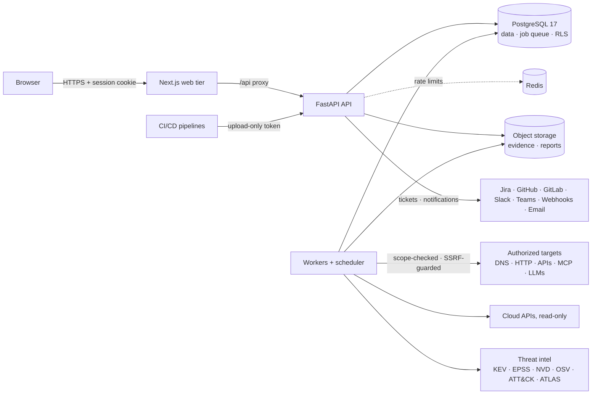

<div align="center">

# CTEM Platform

**Continuous Threat Exposure Management for conventional and AI infrastructure**

Discover what you own, assess it inside an authorized scope, rank findings by real-world risk, trace attack paths, and close the loop with verified remediation — for cloud, web, code and AI systems in one data model.

<a href="https://ai-ctem.onrender.com/"></a>

### [▶ Try the live demo → ai-ctem.onrender.com](https://ai-ctem.onrender.com/)

One-click sign-in for every role, no sign-up · password `Demo-CTEM-2026!` · the first visit after a quiet spell takes about a minute to wake the free instance

[](https://github.com/d0gra/AI-CTEM/actions/workflows/ci.yml)


[](https://pypi.org/project/aictem/)


[Demo](https://ai-ctem.onrender.com/) · [Overview](#overview) · [AI security](#ai-security) · [Architecture](#architecture) · [Deploy](#deploy) · [CLI](#the-aictem-cli) · [Docs](#documentation)

</div>

---

> ### Scan a repository right now, without deploying anything
>
> ```bash
> pip install aictem && aictem discover .
> ```
>
> **`aictem`** is this platform's discovery CLI, on [PyPI](https://pypi.org/project/aictem/). From inside a repository it finds AI providers and SDKs,
> agents and the tools they can call, RAG pipelines, vector stores, MCP servers and clients, model files, dependencies, containers, IaC and
> committed secrets. The standard library is its only dependency. [What it finds →](#the-aictem-cli)

---

## Overview

Security teams rarely lack scanners. They lack one place where every scanner's output, every asset and every piece of business context meet, and where "fixed" means verified rather than asserted.

```text
SCOPE ─► DISCOVER ─► INVENTORY ─► ASSESS ─► PRIORITIZE ─► ATTACK PATHS ─► REMEDIATE ─► RETEST
  ▲                                                                                  │
  └──────────────────────────── schedules, CI/CD uploads, posture changes ──────────┘
```

- **Authorized by construction.** No engine touches a target that isn't covered by a recorded authorization. Active techniques and private networks need their own flags, re-checked at run time.
- **Evidence over assertion.** Findings carry stored evidence and a confidence level, and close only on a retest that no longer observes them, or a recorded manual verification.
- **Transparent risk.** Every score keeps its full breakdown, so a ranking can always be explained.
- **AI is infrastructure.** Model endpoints, agents, MCP servers, RAG systems, vector stores and model files are inventoried and attack-pathed like any other asset.
- **Isolation in the database.** Multi-tenancy is enforced by PostgreSQL row-level security under a role that cannot bypass it, not only by application code.
- **Honest coverage.** Integrations state what they were verified against; [limitations](#known-limitations) are documented, not hidden.

| | |
| --- | --- |
| **Assessment engines** | 13 (discovery, web and API, network, code and dependencies, cloud, AI, AI red team) |
| **Connectors** | 26 (11 scanners, 6 threat-intel feeds, 3 ticketing, 3 notification, 2 AI, 1 cloud) |
| **Report formats** | 12, including the `aictem` inventory, by hand or from CI/CD with a build gate |
| **Asset model** | 33 asset types (11 AI-specific) and 15 relationship types |
| **Access control** | 9 built-in roles, 33 permissions, custom roles, TOTP MFA |
| **Governance** | 13 default policies with exceptions; 10 report types in PDF, XLSX, CSV and JSON |
| **API** | 121 REST paths (152 operations) with OpenAPI documentation |
| **Tests** | 124 backend against real PostgreSQL, 26 frontend, 32 CLI, 12 browser, plus lint, types, SAST and dependency audit |

---

## What it does

| Stage | Capability |
| --- | --- |
| **Scope** | Authorized targets by domain, CIDR, URL or path, with expiry, authorization notes, and separate flags for active testing and private networks. |
| **Discover** | DNS and certificate transparency; HTTP exposure (headers, cookies, CORS, TLS, exposed files and consoles); Nmap services; OpenAPI analysis; AWS read-only inventory with IAM relationships; repository analysis for dependencies, secrets and AI usage. |
| **Inventory** | One record per asset (type + canonical identifier), merged across sources, with change history, ownership, classification, stale detection and an asset graph. |
| **Assess** | Nuclei, Trivy, Grype, Semgrep, Gitleaks and Checkov run on workers; ZAP, Prowler, SARIF, CycloneDX and SPDX are uploaded by hand or from CI/CD, with an optional severity gate that fails the build. |
| **Prioritize** | Risk = likelihood (severity, EPSS, CISA KEV, exposure, confidence) × impact (criticality, data sensitivity), plus contextual escalators and KEV floors, with configurable policy, SLAs and two-person risk acceptance. |
| **Attack paths** | Shortest exposure chains from internet-facing entry points to critical assets over evidence-backed relationships, graded *verified*, *probable* or *theoretical*. |
| **Remediate** | Tasks with assignee, team and due date; Jira, GitHub and GitLab tickets; one-click retest; manual verification; regressions reopen automatically. |
| **Govern** | Rule-based policies with exceptions and history; hash-chained audit log; executive, technical, compliance and AI reports. |
| **Analyse with AI** | Optional Claude explanations of findings and attack paths. Advisory only, schema-validated, budgeted, and unable to change data. |

---

## AI security

AI systems are first-class assets, not a separate product.

| Area | How it works |
| --- | --- |
| **Discovery** | Repository analysis runs the `aictem` library, so a worker and the CLI give the same result: 51 AI technologies, agents with their tools and capabilities, RAG pipelines, MCP clients and servers, committed provider keys (the value is never stored) and model files. |
| **Shadow AI** | Provider usage is compared with the organization's approved list. With no list set, usage is reported as *unknown* rather than *unapproved*. |
| **Continuous posture** | Rules over agent tools and capabilities, autonomy, memory, delegation, identity, RAG document-level authorization and tenant isolation, mapped to **OWASP LLM Top 10 (2025)**, **MITRE ATLAS** and **NIST AI RMF**. Controls nobody has recorded on an exposed or production asset are reported, so nothing passes for lack of data. |
| **MCP** | Static review of server definitions, plus a live probe limited to `initialize` and `*/list`. `tools/call` is never sent; a hard guard enforces it. |
| **Model files** | Pickle streams are disassembled without being executed; references to code-execution callables are reported with opcode evidence. |
| **AI red team** | 15 deterministic, marker- and canary-based tests inside an authorization, scope, budget and rate-limit envelope. Requested tools are recorded, never run. |

Details: [docs/ai-security.md](docs/ai-security.md).

---

## Architecture

A modular monolith (FastAPI) with a PostgreSQL-backed job queue. The browser talks only to the Next.js server, which proxies `/api/*` to the API. Assessments execute only in workers, behind the scope check and an SSRF-guarded HTTP client.



| Layer | Technology |
| --- | --- |
| API | Python 3.12, FastAPI, Pydantic 2, SQLAlchemy 2 (psycopg 3), Alembic |
| Data | PostgreSQL 17 with row-level security and `pg_trgm`; Redis 7 for shared rate limits; local or S3-compatible storage |
| Jobs | PostgreSQL queue (`FOR UPDATE SKIP LOCKED`) with idempotency, backoff, dead-lettering, a stale-job reaper and per-tenant caps |
| Frontend | Next.js 16 (App Router), React 19, TypeScript, Tailwind 4, TanStack Query and Table, Zod, Recharts, React Flow |
| Security | Argon2id, Fernet with key rotation, TOTP, defusedxml, address-pinned outbound HTTP |
| Observability | Structured JSON logs, Prometheus metrics, optional OpenTelemetry, Grafana dashboard and alert rules |

Full description: [docs/architecture.md](docs/architecture.md). Decisions are recorded as [ADRs](docs/adr/).

### Security model

Forced row-level security on every tenant table under a `NOSUPERUSER NOBYPASSRLS` role · Argon2id, lockout, TOTP, hashed server-side sessions, CSRF · 33 permissions, and nobody can grant one they don't hold · one HTTP client that resolves, validates and pins every destination and always refuses link-local and cloud-metadata addresses · credentials encrypted with rotatable keys and never returned by the API · append-only hash-chained audit log.

Threat model: [docs/security.md](docs/security.md). Reporting: [SECURITY.md](SECURITY.md).

---

## Deploy

**One image runs the whole platform.** The role is the command.

```bash
docker pull ghcr.io/d0gra/ai-ctem:0.3.0

docker run ghcr.io/d0gra/ai-ctem:0.3.0 migrate   # apply database migrations, then exit
docker run ghcr.io/d0gra/ai-ctem:0.3.0 all       # web, API and worker in this container (the default)
docker run ghcr.io/d0gra/ai-ctem:0.3.0 serve     # web and API only, when workers run separately
docker run ghcr.io/d0gra/ai-ctem:0.3.0 worker    # background jobs only
```

PostgreSQL, Redis and object storage are external. The web server and the API always run together, because the browser talks only to the web tier and its `/api/*` proxy destination is compiled into the build; workers are what you scale separately. Released images carry build provenance and an SBOM attestation:

```bash
gh attestation verify oci://ghcr.io/d0gra/ai-ctem:0.3.0 --owner d0gra
```

| Target | How |
| --- | --- |
| **Single host** | `cp .env.example .env`, then `docker compose up -d` — PostgreSQL, Redis, migrations, the app and a worker |
| **Kubernetes** | `kubectl apply -f infrastructure/kubernetes/ctem.yaml` — the same image as a migrate Job, a `serve` Deployment and a `worker` Deployment |
| **Public demo** | `Dockerfile.demo` is a separate all-in-one image with PostgreSQL bundled, sized for Render's free plan ([docs/demo.md](docs/demo.md)) |

Scaling, migrations, client addresses, backup, retention and the hardening checklist: **[docs/deployment.md](docs/deployment.md)**.

### Local development

Requirements: Python 3.12 with [uv](https://docs.astral.sh/uv/), Node.js 22 with pnpm 9, PostgreSQL 17.

```bash
./scripts/dev-db.sh                                   # PostgreSQL :54329 and Redis :63799 with dev roles
cd backend && uv sync && uv run alembic upgrade head
CTEM_COOKIE_SECURE=false uv run uvicorn app.main:app --reload --port 8000   # API
uv run python -m app.workers.runner                                        # worker + scheduler
cd ../frontend && pnpm install && pnpm dev                                 # web on :3000
```

Open <http://localhost:3000> and create an organization. `python3 scripts/lab.py` starts deliberately weak local targets (web app, API, MCP server, toy model) to try the active engines against; authorize `http://127.0.0.1:8808` in scope and set `CTEM_ALLOW_PRIVATE_TARGETS=true`.

### Key configuration

All settings are `CTEM_`-prefixed environment variables; the full list is in [`.env.example`](.env.example).

| Variable | Purpose |
| --- | --- |
| `CTEM_ENV` | `development`, `test` or `production`; production validates secrets and secure cookies |
| `CTEM_DATABASE_URL` / `CTEM_MIGRATION_DATABASE_URL` | Runtime role (subject to RLS) and schema-owner role (migrations) |
| `CTEM_SECRET_KEY` / `CTEM_ENCRYPTION_KEYS` | Token hashing key; Fernet keys (first encrypts, all decrypt) |
| `CTEM_REDIS_URL` | Shared rate limiting; required with more than one replica |
| `CTEM_TRUSTED_PROXIES` / `CTEM_UPSTREAM_PROXY` | Which proxies may supply the client address |
| `CTEM_ALLOW_PRIVATE_TARGETS` | Permit assessing private networks that are also authorized in scope |
| `CTEM_REPO_SCAN_ROOT` | Directory under which repositories may be analysed |
| `CTEM_RETENTION_*_DAYS` | How long operational records are kept (`0` keeps them forever) |
| `CTEM_DEMO_MODE` | Public demo behaviour. Never enable on a real deployment |

---

## The aictem CLI

[](https://pypi.org/project/aictem/)
[](https://pypi.org/project/aictem/)


`aictem` runs where the code lives — a laptop or a CI job — and inventories a repository from the inside.

```bash
pip install aictem                            # or pipx install aictem / uv tool install aictem
aictem discover .                             # summary of assets and findings
aictem discover . --vulns                     # known vulnerabilities for pinned packages, via osv.dev
aictem discover . -f sarif -o aictem.sarif    # for GitHub code scanning
aictem discover . -f json -o inventory.json   # full inventory; upload this to the platform
aictem discover . --upload --gate high        # or send it straight there (CTEM_URL, CTEM_CI_TOKEN)
```

| Finds | How |
| --- | --- |
| **AI providers and models** | SDK imports and dependencies, `provider:model` identifiers, endpoint URLs, environment variables, containers and IaC. 51 providers, frameworks, vector stores and serving runtimes |
| **Agents and their tools** | 13 agent frameworks. Tools are attached to the agents that import them, classified by capability (payment, shell, file write, email, …) and checked for an approval step |
| **RAG and vector stores** | Vector store clients together with retrievers, loaders and embeddings |
| **MCP** | Client configurations, servers declared in code, and servers implemented in the repository with their registered tools |
| **Models** | Pickle, PyTorch, safetensors, ONNX, GGUF and more, disassembled without loading; Hugging Face references and `trust_remote_code` |
| **Everything else** | Packages from 8 ecosystems (21 manifest and lockfile formats), container images, Kubernetes, Terraform, CloudFormation, CI pipelines and committed secrets (values never stored) |

Inside the platform, **Add asset** walks through the same steps and accepts the inventory file directly. Full reference: [cli/README.md](cli/README.md).

---

## Integrations

Each integration states what it was verified against during development.

| Integration | Mode | Verified against |
| --- | --- | --- |
| Nmap, Nuclei | Tool on workers | Real binaries against local listeners |
| Trivy, Grype, Semgrep, Gitleaks, Checkov | Tool, upload or CI/CD | Real binaries against a sample repository |
| OWASP ZAP, Prowler, SARIF, CycloneDX, SPDX | Upload or CI/CD | Representative report files |
| CISA KEV, FIRST EPSS, NIST NVD, MITRE ATT&CK, MITRE ATLAS, OSV | Feed | The live public sources |
| DNS and certificate transparency | Built-in discovery | Live DNS and crt.sh |
| AWS | Connect, read-only | moto (AWS API emulation); not yet a real account |
| Jira Cloud, GitHub Issues, GitLab Issues | Ticketing | Recorded API shapes; not yet real accounts |
| Slack, Microsoft Teams, signed webhooks, SMTP | Notifications | Local receivers |
| Claude, OpenAI-compatible, Gemini, custom HTTP | AI analysis and red-team targets | Official SDK and recorded stand-ins |

**CI/CD.** Pipelines upload to `POST /api/v1/ci/ingest` with an upload-only token from **Integrations → CI/CD pipelines**, which also generates ready-to-use GitHub Actions, GitLab CI, Jenkins and shell jobs. A severity gate returns HTTP 412 so `curl --fail-with-body` fails the build. Per-connector permissions: [docs/integrations.md](docs/integrations.md).

---

## Operations

| Concern | Provided |
| --- | --- |
| Health | `GET /healthz` (liveness), `GET /readyz` (database and Redis) |
| Metrics | `GET /metrics` on the API, `CTEM_WORKER_METRICS_PORT` on workers; Prometheus config, alerts and a Grafana dashboard in `infrastructure/monitoring/` |
| Jobs | Retried with backoff, dead-lettered when they keep failing, re-queued if a worker dies; a jobs view with cancel |
| Retention | A daily job removes finished jobs, expired sessions, old notifications, reports and stored upload files; assets, findings, evidence and the audit log are never removed |
| CLI | `python -m app.cli grant-super-admin`, `verify-audit`, `rotate-secrets`, `purge-expired`, `export-organization`, `delete-organization` |
| API docs | `/api/docs` and `/api/openapi.json`; session cookie plus CSRF for browsers, `Authorization: Bearer` for scripts |

```bash
make test        # backend, frontend and CLI
make lint
make e2e         # browser tests against a demo-mode instance
```

---

## Repository layout

```text
backend/app/
  api/            authentication, RBAC and pagination dependencies; router aggregation
  core/           configuration, security primitives, SSRF-guarded HTTP, rate limits, storage, logging
  domains/        one package per domain: auth, admin, assets, findings, assessments, ci, risk, policy,
                  attack_paths, remediation, intel, ai, analytics, notifications, reports, audit, platform
  engines/        assessment engines (discovery, web/API, scanners, AWS, AI, AI red team)
  integrations/   connector framework, scanner parsers, intel feeds, ticketing, notifications, LLM clients
  workers/        job queue, worker and scheduler
backend/migrations/  Alembic migrations, including row-level security policies and grants
frontend/            Next.js app: 20 product areas, shared data table, feature components, browser tests
cli/                 aictem discover: dependency-free repository and AI asset discovery
infrastructure/      Kubernetes manifests, the production entrypoint, Postgres bootstrap, monitoring
docs/                architecture, deployment, security, integrations, AI security, API, demo, ADRs
Dockerfile           the production image; Dockerfile.demo is the separate public-demo image
```

---

## Known limitations

- **Identity.** No OIDC or SAML single sign-on, and no SCIM provisioning.
- **Cloud.** AWS is the only native cloud connector; Azure and Google Cloud come in through Prowler reports. No live Kubernetes inventory.
- **Web testing.** Passive analysis and safe read-only probes only; no crawler and no injection testing. Use ZAP, Nuclei or Semgrep and import the results.
- **Repositories.** Analysed from a path on the worker; there is no Git provider connector.
- **Attack paths.** Built from recorded relationships; network reachability is not computed, so a path can be overstated.
- **AI red team.** Single-turn tests; no multi-turn, multimodal or adaptive attacks.
- **Verification.** Not yet exercised against real AWS, Jira, GitHub, GitLab, Slack or Teams accounts, or live Claude, OpenAI or Gemini APIs. The Kubernetes manifests have not been applied to a real cluster.
- **Scale.** Exercised with hundreds of assets per organization; no load tests yet.

**Roadmap:** OIDC and SCIM · Azure and Google Cloud connectors · Git provider connectors with isolated clone-and-analyse · Kubernetes inventory and RBAC analysis · multi-turn AI red-team tests · reachability-aware attack paths.

---

## Documentation

| Guide | Contents |
| --- | --- |
| [Architecture](docs/architecture.md) | Components, request path, data model, finding lifecycle, risk engine, jobs |
| [Deployment](docs/deployment.md) | The image and its roles, scaling, migrations, backup, retention, releases, hardening |
| [Security](docs/security.md) | Threat model, sessions, tenant isolation, key management, assessment safety, known gaps |
| [Integrations](docs/integrations.md) | Every connector, required permissions, CI/CD ingestion |
| [AI security](docs/ai-security.md) | Discovery, posture rules, MCP, model files, red team |
| [API](docs/api.md) | Authentication, conventions, resource map, a worked discovery-to-report example |
| [Development](docs/development.md) | Local setup, conventions, adding an engine, tests, troubleshooting |
| [Public demo](docs/demo.md) | Demo image, Render deployment, memory budget, restrictions |
| [CLI](cli/README.md) | `aictem discover`: install, usage, what it finds, exit codes |
| [Changelog](CHANGELOG.md) | Release history |

## Contributing, security and licence

Contributions are welcome — see [CONTRIBUTING.md](CONTRIBUTING.md). Report vulnerabilities privately as described in [SECURITY.md](SECURITY.md), not through public issues. Licensed under the [MIT License](LICENSE).
