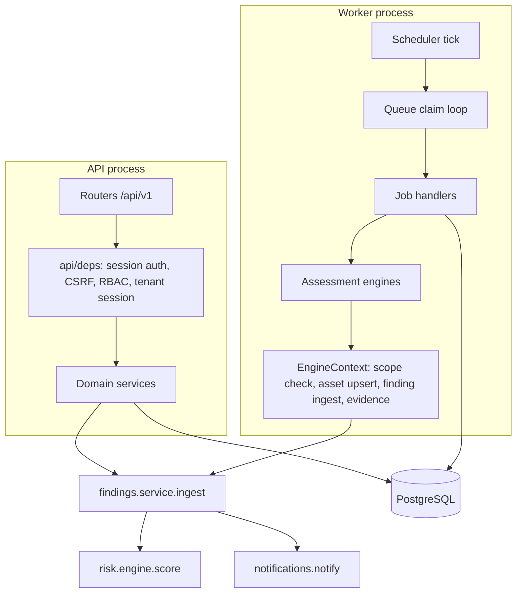

# Architecture

## Shape

One deployable API (a modular monolith), one worker image, one web frontend. Domains are Python packages with their own router and service module; they share one database schema and call each other through service functions, not HTTP. This keeps tenant isolation, transactions and the finding lifecycle in one place. Splitting a domain into a service later means moving a package and replacing function calls, not untangling a shared database.



## Request path

1. `request_middleware` assigns a request id, applies the per-IP rate limit, records metrics and adds security headers.
2. `get_principal` resolves the session token (cookie or bearer) in a *system session*, checks expiry, idle timeout, account state and, for cookie-authenticated unsafe methods, the CSRF token.
3. `require(...)` checks permissions; denials are audited.
4. `get_db` opens a *tenant session*. Its `after_begin` hook sets `app.current_org` for every transaction, which the row-level security policies read.

## Data model

48 tables in six model modules:

- `identity`: organizations, users, roles, role_permissions, permissions, teams, sessions, user_tokens.
- `asset`: assets, asset_relationships, asset_discovery_events, scope_targets.
- `finding`: vulnerabilities (global), findings, ai_findings, evidence, finding_events, risk_scores, risk_acceptances, remediation_tasks.
- `assessment`: jobs, assessments, assessment_targets, assessment_runs.
- `ai`: ai_assets, ai_models, ai_agents, mcp_servers, ai_integrations, ai_assessments, ai_assessment_tests, ai_usage.
- `governance` and `ops`: attack_paths (+nodes, edges), threat_intelligence and intel_sync_state (global), policies, policy_evaluations, policy_exceptions, integrations, notifications (+reads, rules, deliveries), reports, audit_events.

AI entities are extensions of `assets` (`ai_assets`, `ai_agents`, `mcp_servers`, `ai_models` share the asset's primary key), so AI systems take part in relationships, findings, attack paths, policies and reports without special cases. JSONB is used for provider-specific attributes, evidence content, engine configuration and rule documents; everything queried or joined is relational.

## Finding lifecycle

All producers (engines, scanner imports, manual entry, red-team runner) create a `FindingInput` and call `findings.service.ingest`:

- De-duplication key: `sha256(asset_id | source | rule_id | discriminator)`. A second scanner reporting the same CVE is a separate observation linked to the same catalogue vulnerability.
- Re-observation of a remediated or closed finding reopens it and restarts its SLA.
- After a run that fully assessed an asset, `reconcile_unobserved` marks findings in `pending_validation` as remediated (the retest verified the fix). Other open findings that were not observed are only annotated: absence from one scan is not treated as proof.
- Status changes go through an explicit transition table. `remediated` and `accepted_risk` cannot be set by hand.

## Risk engine

Pure functions in `domains/risk/engine.py`:

```
likelihood = threat × (0.5 + 0.5 × exposure) × confidence
impact     = severity × (0.6 + 0.4 × asset_impact)
score      = min(100, max(floors, 100 × likelihood × impact + escalators))
```

`threat` comes from KEV (1.0), a public exploit (0.85), EPSS percentile (0.4–1.0) or a neutral default; `severity` from CVSS when known, otherwise the engine's severity. Escalators are additive points for attack-path position, privileged identity and AI factors (autonomy, unapproved high-impact tools, sensitive data, missing tenant isolation). Floors apply to known-exploited vulnerabilities. Every factor, its input and its reason is stored with the score. Parameters live in the organization's risk policy and are versioned.

## Attack paths

`domains/attack_paths/engine.py` builds a directed graph from `asset_relationships`, with a traversal rule per relationship type (for example `RETRIEVES_FROM` is traversable in reverse as indirect prompt injection, `HAS_PERMISSION` forward as permission use). Entry points are internet-exposed assets and attacker-writable data sources; targets are critical or sensitive assets. A bounded-depth lowest-cost search runs from each entry. Each hop is graded from the strongest open finding on the node being left and the relationship's confidence; a path's classification is its weakest hop, and a path is reported only if at least one hop has an enabling finding. Agents whose high-impact tools all require human approval make tool-use hops theoretical.

## Jobs

`workers/queue.py`: jobs are rows; workers claim with `FOR UPDATE SKIP LOCKED`. Idempotency is a partial unique index over active jobs per `(organization, key)`. Transient failures back off exponentially up to `max_attempts`, then move to `dead`. Running jobs heartbeat; a reaper requeues stale ones. Cancellation is cooperative at `progress()`/`checkpoint()` calls. A per-organization cap on running jobs prevents one tenant from starving others.

## Frontend

All pages under `app/(app)` are client components that read through TanStack Query. `components/data-table.tsx` sends pagination, sorting, search and filters to the API. Forms with business rules use React Hook Form with Zod schemas (`lib/schemas.ts`); engine and connector configuration forms are generated from the JSON Schema the API publishes, so adding an engine does not require frontend changes. Permissions returned by `/auth/me` hide controls the user cannot use; the API remains the enforcement point.

## Significant decisions

Recorded in [docs/adr](adr/): tenant isolation with RLS, PostgreSQL job queue, synchronous SQLAlchemy, authorized scope as a hard precondition, deterministic AI red-team detection.
